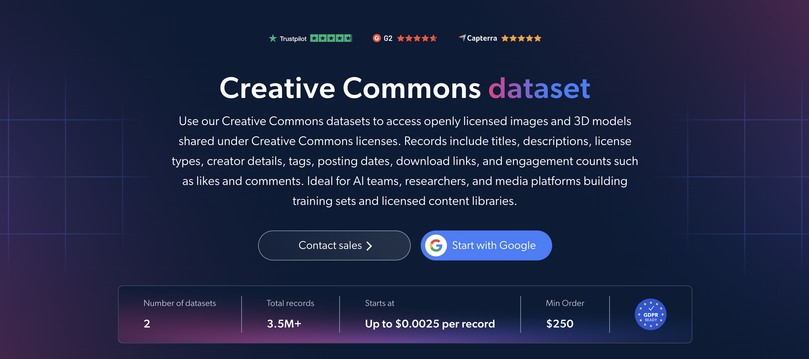

# Creative Commons 数据集样本

<h2>包含 1000 个知识共享 3D 模型的样本数据集</h2>

<a href="https://www.bright.cn/products/datasets/creative-commons">
   
</a>

一个包含 1000 个采用开放许可的 3D 模型的知识共享数据集样本。该数据集使用 <b>Bright Data API</b> 提取。

<h2>该数据集包含的部分数据点：</h2>

* ```url```：3D 模型页面的 URL
* ```id```：每个 3D 模型的唯一标识符
* ```domain```：3D 模型的来源域名
* ```title```：3D 模型的标题
* ```description```：3D 模型的描述
* ```license```：3D 模型的知识共享许可类型
* ```images```：3D 模型的预览图像
* ```creator_details```：3D 模型创作者的详细信息
* ```tags```：与 3D 模型关联的标签
* ```date_posted```：3D 模型的发布日期
* ```download_url```：3D 模型文件的下载 URL
* ```num_files```：3D 模型包含的文件数量
* ```num_likes```：3D 模型的点赞数
* ```num_comments```：3D 模型的评论数
* ```print_settings```：推荐的 3D 打印设置

这是“知识共享 3D 模型（公开数据）”数据集的样本子集，该完整数据集包含超过 <b>24,000 个 3D 模型</b>。

可用的数据集文件格式：<b>JSON、NDJSON、JSON Lines、CSV、XLSX 或 Parquet。文件还可选择压缩为 .gz 格式</b>。

数据集交付方式选项：<b>电子邮件、API 下载、Webhook、Amazon S3、Google Cloud Storage、Google Cloud PubSub、Microsoft Azure、Snowflake、SFTP</b>。

更新频率：<b>一次性、每日、每周、每月、每季度、每半年或自定义</b>。

可在提取的数据点基础上额外提供数据丰富服务：<b>按需提供。</b>

<b>[获取完整的知识共享数据集](https://www.bright.cn/products/datasets/creative-commons)</b>。

<a href="https://www.bright.cn/products/datasets/creative-commons">
</a>

<h2>知识共享数据集有哪些使用场景？</h2>

<h3>1. AI 训练数据</h3>
AI 团队使用知识共享数据集，基于采用开放许可的模型构建 3D 训练集。通过许可类型和标签进行筛选，并结合直接下载链接和预览图像，不仅可以明确使用条款，还能轻松为 3D 生成、计算机视觉和多模态模型整理数据。

<h3>2. 许可合规</h3>
企业会核查每个 3D 模型的许可和创作者信息，以正确标注来源，并确保仅按照相应许可允许的方式重复使用。这可以降低在产品、游戏、研究或 3D 打印项目中使用开放 3D 内容时的法律风险。

<h3>3. 内容趋势与创作者发现</h3>
平台和品牌利用标签、发布日期、点赞数和评论数，追踪不同主题和风格随时间变化的发布及受欢迎程度。这有助于发现开放 3D 内容中的新兴趋势，并找出最具吸引力的创作者，以开展合作、委托创作或社区项目。

<h2>面向学术研究人员和 NGO 免费开放网页爬虫工具与数据集</h2>

Bright Initiative 为顶尖高校院系和研究人员，以及致力于推动各类环境和社会事业的 NGO 与 NPO，提供 Bright Data 的 <b>[爬虫工具 API](https://www.bright.cn/products/web-scraper)</b> 和 <b>[即用型数据集](https://www.bright.cn/products/datasets)</b>。你可以在<b>[此处](https://brightinitiative.com)</b>提交申请。
